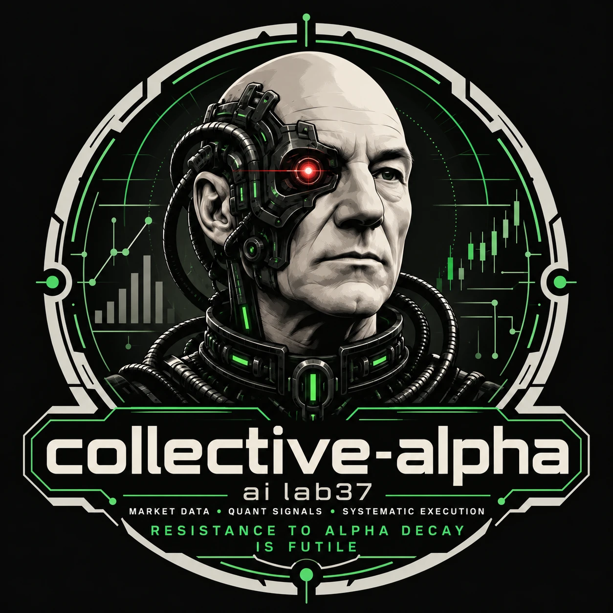
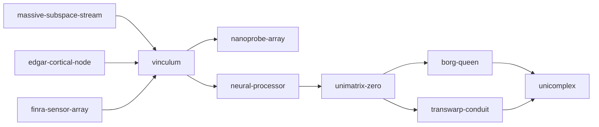

<p align="center"></p>

# collective-alpha

[](https://github.com/yurit04/collective-alpha/actions/workflows/ci.yml)

Assimilation of multi-asset market data, quantitative signals, and systematic execution algorithms. Resistance to alpha decay is futile.

A personal quant platform for US equities, end to end: market data, SEC fundamentals and FINRA
short data, stored locally and joined point in time; signals; backtests; a factor risk model and
optimizer; and paper execution through Interactive Brokers.

## How it fits together

One [uv](https://docs.astral.sh/uv/) workspace. Reusable **core** packages form a dependency
DAG; **projects** use core packages and never each other.



<sub>An arrow points from a package to one that depends on it. Indirect dependencies are left
out; `uv run python tools/check_architecture.py --graph` prints the full graph.</sub>

| Package | CLI | What it does |
|---|---|---|
| [`massive-subspace-stream`](core/massive-subspace-stream/README.md) | `subspace` | [Massive](https://massive.com) equity data: backfill, live stream, pandas/polars queries, security master |
| [`edgar-cortical-node`](core/edgar-cortical-node/README.md) | `cortical` | SEC EDGAR company facts: point-in-time fundamentals and share counts by CIK |
| [`finra-sensor-array`](core/finra-sensor-array/README.md) | `sensor` | FINRA short interest (from 2017) and daily short sale volume (from 2009) |
| [`vinculum`](core/vinculum/README.md) | `vinculum` | The join: checked CIKs, daily market cap, public float, size universes, fundamentals and short data per security |
| [`neural-processor`](core/neural-processor/README.md) | | ~50 point-in-time signals in seven groups (value, profitability, quality, leverage, growth, price, short interest), transforms and composites |
| [`unimatrix-zero`](core/unimatrix-zero/README.md) | | Backtests: returns across successors with delisting exits, portfolio builders, daily engine with lag and costs, analytics |
| [`borg-queen`](core/borg-queen/README.md) | `queen` | Factor risk model (market, sector, style), covariance forecasts, attribution; cost-aware optimizer |
| [`transwarp-conduit`](core/transwarp-conduit/README.md) | `conduit` | Execution through Interactive Brokers: order sheets with limits, paper-first market-on-close orders, journal, reconciliation |
| [`nanoprobe-array`](core/nanoprobe-array/README.md) | `nanoprobe` | Intraday: minute bars resampled on a session clock with gap rules, auction prices, per-bar features, daily intraday summaries since 2003 |
| [`unicomplex`](core/unicomplex/README.md) | `collective` | Orchestration: `collective status`, a read-only freshness report over every store |

Projects:

- [`subspace-probe`](projects/subspace-probe/README.md): demo notebooks, one folder per core
  package, each using only that package and its dependencies. Outputs are committed, so they
  read on GitHub.

## Quick start

```bash
uv sync --all-packages
```

Load the data once. These are long downloads, so pick what you need:

```bash
uv run subspace init                 # checks credentials (~/.massive.env) and plan coverage
uv run subspace backfill initial     # reference data, day + minute bars since 2003, REST datasets
uv run cortical init
uv run cortical backfill             # SEC company facts: 1.4 GB, ~10-20 min
uv run cortical profiles             # company profiles and name history: 1.6 GB
uv run sensor backfill short-interest
uv run sensor backfill short-volume  # ~13,000 files, ~3 GB
uv run vinculum build                # the join, ~30 s
```

After that, `tools/nightly_sync.sh` (or each package's `service install`) keeps the stores
current, and one command says whether they are:

```bash
uv run collective status
```

From a signal to a backtest:

```python
from neural_processor import Processor, composite
from unimatrix_zero import Engine, quantile_weights

names = ["fcf_yield", "roe", "momentum_12_1"]
sig = composite(Processor().panel(names, start="2012-01-01", top=1000), names, name="score")
bt = Engine().run(quantile_weights(sig, "score", q=0.2))   # long top fifth, short bottom fifth
bt.summary()
```

Paper trading needs IB Gateway logged in to a paper account; see the
[transwarp-conduit README](core/transwarp-conduit/README.md).

## Development

```bash
uv run pytest                                  # offline tests (live API tests: -m live)
uv run ruff check .
uv run python tools/check_architecture.py      # dependency rules, notebooks included
```

CI runs all three on Python 3.12 and 3.13 for every push to `main` and every pull request.

- Design records ("why X over Y") live in [`docs/decisions/`](docs/decisions/).
- Agent guidance lives in [CLAUDE.md](CLAUDE.md); each core package has its own `CLAUDE.md`
  describing its public API. Claude Code skills in [`.claude/skills/`](.claude/skills/) scaffold
  new core packages and projects and explain how to query the data.
